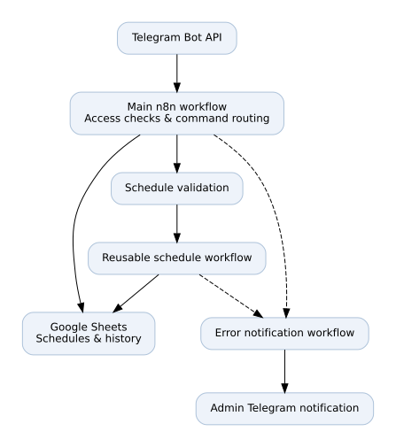
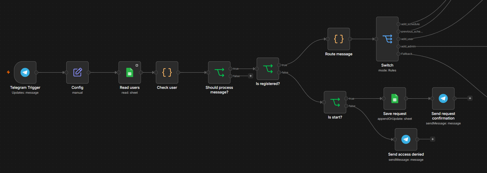
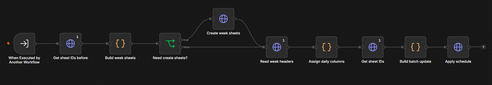
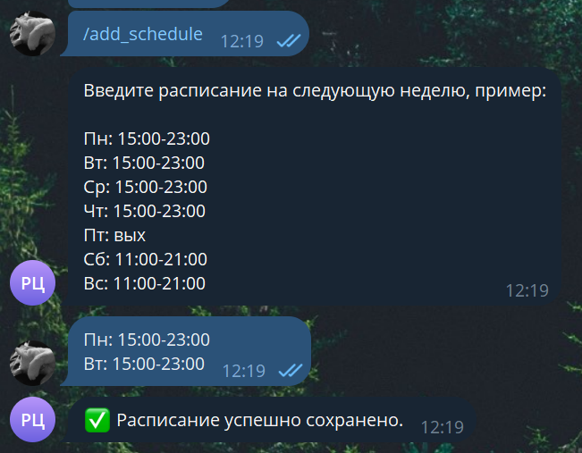

# Schedule Automation Bot

**A Telegram-based employee scheduling automation system built with n8n and Google Sheets.**

> Portfolio case study. The production workflows, credentials, and internal organization data are not publicly available.

## Overview

This project automates the collection and updating of employee work schedules. Employees submit their availability through a Telegram bot; n8n validates the messages and coordinates updates to Google Sheets. The solution was developed as a personal project for an organization and is currently used in its operations.

## Key features

- Submit weekly schedules through Telegram using simple day/time messages.
- Validate incoming commands and schedule formats.
- Create or reuse weekly Google Sheets tabs and map shifts to the appropriate cells.
- Update individual days without duplicating existing shift records.
- Support different scheduling templates for weekdays and weekends.
- Reuse previously submitted schedules and maintain schedule history.
- Handle user access and administrative requests.
- Route workflow failures to a dedicated Telegram error notification workflow.
- Keep testing and production bot configurations separate.

## Technology stack

| Technology | Purpose |
| --- | --- |
| n8n | Workflow orchestration and business logic |
| Telegram Bot API | Employee-facing chat interface |
| Google Sheets API | Schedule storage and updates |
| JavaScript | Data validation and transformation in n8n Code nodes |
| HTTP / JSON | API integrations and data exchange |

## Architecture



The main n8n workflow handles incoming Telegram messages, access checks, command routing, schedule parsing, and replies. A reusable sub-workflow prepares weekly sheets, assigns employee columns, and applies updates in batches. A separate error workflow sends operational notifications.

## Example interaction

```text
Employee: /add_schedule
Bot: Please send your schedule for next week.
Employee:
Mon: 15:00-23:00
Tue: 15:00-23:00
Bot: Schedule saved successfully.
```

*Example messages are illustrative and contain no real employee data.*

## Screenshots

### Main workflow — User authentication and command routing

The main workflow processes incoming Telegram messages, checks user access permissions, and routes commands to the appropriate automation branches.



### Schedule application sub-workflow

A reusable n8n workflow that creates weekly sheets, assigns employee columns, prepares batch updates, and applies schedules through the Google Sheets API.



### Telegram bot interaction

An example of submitting a weekly schedule through Telegram and receiving confirmation after successful processing.



## Project outcome

A working scheduling assistant used in an organization's daily operations. It reduces repetitive manual entry and provides a consistent workflow for submitting and updating schedules. No quantitative time-savings claim is made because this has not been measured.

## Source availability

This repository is **documentation-only**. It intentionally does not include production workflow exports, source code, access tokens, employee information, spreadsheet identifiers, or internal URLs.

## Author

[Carpeet](https://github.com/Carpeet) — project design, implementation, testing, and maintenance.
